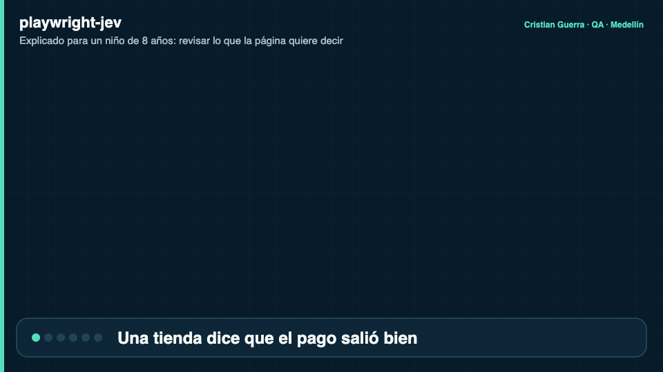

# playwright-jev

[Read in English](README.md)


## Explicado para un niño de 8 años

Cuando la página de una tienda dice "Payment successful. Your order is confirmed." (pago exitoso, tu pedido está confirmado), una prueba normal revisa si ciertas palabras exactas están en la pantalla. Si alguien reescribe la frase, esa prueba se rompe aunque la página esté bien. Este proyecto deja que la prueba pregunte qué **quiere decir** la página: "¿dice que el pago se confirmó?". Jev responde qué tan seguro está. Solo pasa un sí claro; si Jev queda en la mitad o no responde, la prueba falla a propósito, para que nada se cuele. Las respuestas se pueden guardar, así las pruebas vuelven a correr igual sin internet.

**Un ejemplo real de este repo**

- **Imagina** una página de pago que muestra: "Payment successful. Your order A-1001 is confirmed. A receipt was sent to ana@example.com."
- **Qué pasa:** la prueba quiere saber si "the payment was confirmed" (el pago fue confirmado). Esas palabras exactas no están en la página, así que una revisión palabra por palabra fallaría, aunque la página está bien.
- **Qué hace el proyecto:** Jev lee el sentido y dice **98%** que sí. Para "the payment failed" (el pago falló) dice **1%**, que es justo lo que queremos. Las dos revisiones pasan.
- **Qué ganamos:** pruebas que no se rompen cuando cambia la redacción y que igual fallan cuando la página de verdad dice otra cosa. En el CI las 10 revisiones de sentido pasan con respuestas guardadas, sin internet y sin llave.



[Versión MP4](docs/assets/explained.es.mp4) · fuente: [`docs/scenes/explained.html`](docs/scenes/explained.html) (con `?lang=es`)

**Palabras difíciles**

| Palabra | Qué quiere decir |
| --- | --- |
| Playwright | Una herramienta que maneja un navegador sola, como un robot que hace clic por ti |
| Aserción | La línea de "¿esto es verdad?" dentro de una prueba |
| Jev | Una IA rápida que no escribe frases: responde sí o no y dice qué tan segura está |
| Umbral | Qué tan seguro tiene que estar Jev (80% por defecto) para que un sí cuente |
| Fixture | Una respuesta de Jev guardada, para que la prueba vuelva a correr sin preguntar |
| CI | Un robot que corre las pruebas cada vez que alguien entrega un cambio |

---

Aserciones semánticas para [Playwright Test](https://playwright.dev), con
[Jev](https://docs.typesafe.ai) de TypeSafe AI. En lugar de comparar textos exactos,
verifica lo que la pantalla *significa*.

```ts
await expect(page.getByRole('alert')).toMean('the payment was confirmed');
await expect(summary).toMeanAll(['the order total is shown', 'the page says when it will arrive']);
await expect.soft(alert).not.toMean('the payment failed');
await expect(banner).toChoose(['success', 'error', 'pending'], 'success');
await expect(article).toBeScored(['unclear', 'partly clear', 'clear'], { atLeast: 1.5 });
```

[](https://github.com/criguex/playwright-jev/actions/workflows/ci.yml)
Licencia: MIT · Node ≥ 20 · `@playwright/test` ≥ 1.45

## Por qué

Una aserción sobre un locator responde "¿está este texto exacto en la pantalla?". Un
criterio de aceptación casi siempre pregunta otra cosa: "¿la pantalla le dice al usuario
que el pago se hizo?". Cuando el texto se reescribe, se traduce o entra en una prueba A/B,
el primer tipo de prueba se rompe aunque el producto esté bien, y una regex que intenta
cubrir todas las redacciones termina sin afirmar nada.

Jev es un modelo "System One": recibe un estado y preguntas tipadas, y devuelve
probabilidades calibradas en vez de prosa, en unos cientos de milisegundos, a $0.042 por
millón de tokens de entrada. Eso lo hace útil como oráculo de aserciones, siempre que la
librería que lo envuelve sea estricta con la incertidumbre. Esta lo es:

- **Veredictos de tres valores.** Cada respuesta es `yes`, `no` o `ambiguous`. Lo ambiguo
  falla por defecto, tanto en `toMean` como en `.not.toMean`.
- **Falla cerrada.** Sin llave, un 429 después de los reintentos, un timeout o un fixture
  que falta dejan la aserción como *unverified*, y unverified nunca pasa. Si quieres,
  `onUnverified: 'skip'` salta la prueba con un aviso.
- **Evidencia en cada aserción.** Probabilidad, confianza, distribución, fuente, modelo,
  latencia y costo quedan adjuntos al reporte de Playwright y el reporter los lista.
- **CI offline.** Grabas las respuestas una vez, versionas los fixtures y reproduces de
  forma determinista sin llave ni red.

### En qué se diferencia de lo que ya existe

| Proyecto | Alcance |
| --- | --- |
| [pytest-jev](https://github.com/allebee/pytest-jev) | Python / pytest |
| [jevtest](https://github.com/realZachi/jevtest) | Matchers para Vitest y Jest (`toSatisfy`), sin Playwright |
| [jev-playwright](https://www.npmjs.com/package/jev-playwright) | Escoge qué pruebas de Playwright correr para un diff, no hace aserciones |
| playjev, jev-browser | Agentes de automatización de navegador |
| **playwright-jev** | Matchers para Playwright Test: receptores `Locator`/`Page` con reintento web-first, matchers noul/choice/score, banda de ambigüedad, anotaciones de Playwright, adjuntos y reporter |

## Cómo funciona


La animación sigue el ejemplo de checkout de [`examples/checkout.spec.ts`](examples/checkout.spec.ts) y muestra la salida real de `npm run test:examples` (modo replay, sin llave) ([versión MP4](docs/assets/how-it-works.mp4)). Fuente: [`docs/scenes/how-it-works.html`](docs/scenes/how-it-works.html), renderizada con [`docs/scenes/export.sh`](docs/scenes/export.sh). Las imágenes están en inglés y son las mismas en las dos versiones del README.

## Inicio rápido

El paquete todavía no está publicado en npm (`npm i -D playwright-jev` da 404).
Instálalo desde GitHub; el script `prepare` construye `dist/` durante la instalación.

```sh
npm i -D github:criguex/playwright-jev
export TYPESAFE_API_KEY=...        # o AI_GATEWAY_API_KEY=... para Vercel AI Gateway
```

```ts
// tests/checkout.spec.ts
import { test } from '@playwright/test';
import { expect } from 'playwright-jev';

test('a successful payment is communicated as a confirmation', async ({ page }) => {
  await page.goto('/checkout');
  await page.getByRole('button', { name: 'Pay now' }).click();
  const alert = page.getByRole('alert');

  await Promise.all([
    expect.soft(alert).toMean('the payment was confirmed'),
    expect.soft(alert).toMean('the customer will receive a receipt by e-mail'),
    expect.soft(alert).not.toMean('the payment failed'),
  ]);
});
```

Esas tres aserciones leen el mismo texto y le llegan a Jev como **una sola** solicitud.

Agrega el reporter a `playwright.config.ts`:

```ts
import { defineConfig } from '@playwright/test';

export default defineConfig({
  reporter: [['list'], ['playwright-jev/reporter', { markdownFile: 'jev-report.md' }]],
});
```

¿Ya tienes un `expect` propio? Combina los matchers:

```ts
import { expect as base, mergeExpects } from '@playwright/test';
import { jevMatchers } from 'playwright-jev';

export const expect = mergeExpects(myExpect, base.extend(jevMatchers));
```

## API

| Matcher | Primitiva de Jev | Pasa cuando |
| --- | --- | --- |
| `toMean(claim, opts?)` | noul | p ≥ `threshold` (0.8 por defecto). `.not`: p ≤ 1 − threshold |
| `toMeanAll(claims, opts?)` | noul × N, una solicitud | todas las afirmaciones son `yes` (AND de Kleene) |
| `toMeanAny(claims, opts?)` | noul × N, una solicitud | al menos una afirmación es `yes` (OR de Kleene) |
| `toBeScored(rubric, { atLeast, atMost?, minConfidence? })` | score | `atLeast ≤ score ≤ atMost` y confianza ≥ `minConfidence` (0.5) |
| `toChoose(options, expected, { question?, minConfidence? })` | choice | la opción elegida ∈ `expected` y confianza ≥ `minConfidence` |

Receptores:

| Receptor | Qué se juzga | Reintentos |
| --- | --- | --- |
| `Locator` | `innerText` de todas las coincidencias, después de que la primera es visible | sí, hasta que la expectativa se cumple o se acaba el `timeout`; a Jev solo se le vuelve a preguntar cuando el texto cambia |
| `Page` | inner text del `body` | sí |
| `string`, `number`, `boolean` | el valor | no |
| `APIResponse` | el cuerpo JSON parseado, o el texto | no |
| objeto / arreglo | el valor JSON | no |

Opciones comunes a todos los matchers: `timeout`, `poll` (`true` por defecto), `context`
(estado extra, p. ej. `"error banner on the login form"`), `model`, `onAmbiguous`,
`onUnverified`. Los `toMean*` además reciben `threshold`.

Las rúbricas van ordenadas de menor a mayor; `atLeast` y `atMost` usan índices de nivel
desde 0 y pueden ser fraccionarios, porque Jev devuelve un puntaje ponderado por
probabilidad. Las opciones de `toChoose` pueden ser una lista de etiquetas o un mapa de
etiqueta a descripción (hasta 255).

También se exportan las piezas de bajo nivel: `createJevClient`, `decide`,
`claimQuestion`, `choiceQuestion`, `scoreQuestion`, `normalizeAnswer`, `redactors`,
`getJevStats`. Referencia completa: `npm run docs` (typedoc, `docs/api`).

### Salida cuando falla

```
Error: expect(locator).toMean("the payment was confirmed")

Verdict:  no (expected yes)
Thresholds: yes ≥ 0.80, no ≤ 0.20
Answers:
  - "the payment was confirmed": no (p=0.04, live)
Received (locator): "Card declined. Please try another payment method."
Model: jev-1.13.0
```

## Grabar / reproducir

```sh
JEV_MODE=record npx playwright test     # llama a Jev y escribe .jev/fixtures/<hash>.json
git add .jev/fixtures
JEV_MODE=replay npx playwright test     # sin llave, sin red, determinista
```

| `JEV_MODE` | Comportamiento |
| --- | --- |
| `auto` (por defecto) | el fixture si existe; si no, en vivo si hay llave; si no, unverified |
| `live` | siempre llama a Jev (la caché en memoria sigue aplicando) |
| `record` | llama a Jev y escribe un fixture por pregunta |
| `replay` | solo fixtures; un fixture que falta es unverified |
| `off` | toda aserción semántica es unverified |

La llave del fixture es `sha256(model, redacted state, question)`. Si el texto de la página
cambia, la llave cambia y el replay reporta el fixture faltante en vez de aprobar un
contenido que nunca fue juzgado. Los `examples/` de este repositorio corren así en CI, con
fixtures grabados contra el modelo en vivo.

## Configuración

Llama a `configureJev` al principio de `playwright.config.ts` (el archivo se evalúa en cada
worker) o usa variables de entorno. Las opciones por aserción le ganan a `configureJev`, que
a su vez le gana al entorno.

```ts
import { configureJev, redactors } from 'playwright-jev';

configureJev({
  threshold: 0.85,
  onAmbiguous: 'fail',
  onUnverified: 'fail',
  redact: [redactors.emails, redactors.cardNumbers, redactors.digitRuns(8)],
  context: 'web shop checkout',
});
```

| Opción | Variable de entorno | Por defecto |
| --- | --- | --- |
| `mode` | `JEV_MODE` | `auto` |
| `model` | `JEV_MODEL` | `jev-latest` (fija p. ej. `jev-1.13.0` después de ajustar los umbrales) |
| `threshold` | `JEV_THRESHOLD` | `0.8` |
| `minConfidence` | | `0.5` |
| `onAmbiguous` | `JEV_ON_AMBIGUOUS` | `fail` (`annotate` pasa con una anotación `jev:ambiguous`) |
| `onUnverified` | `JEV_ON_UNVERIFIED` | `fail` (`skip` salta la prueba con un aviso) |
| `fixturesDir` | `JEV_FIXTURES_DIR` | `.jev/fixtures` |
| `apiKey` | `TYPESAFE_API_KEY` | |
| `gatewayApiKey` | `AI_GATEWAY_API_KEY` | |
| `baseUrl` | `JEV_BASE_URL` | TypeSafe; si no, Vercel AI Gateway |
| `requestTimeoutMs` | | `15000` (incluye los reintentos) |
| `maxRetries` / `maxRetryDelayMs` | | `2` / `8000` |
| `batchWindowMs` / `maxQuestionsPerRequest` | | `20` / `32` |
| `maxStateChars` | | `60000` (el texto más largo se trunca y se marca) |
| `redact` | | `[]` |
| `pricePerMillionInputTokens` | | `0.042` |

Transporte: con `TYPESAFE_API_KEY` las solicitudes van a `https://api.typesafe.ai/v1/systemone`;
con solo `AI_GATEWAY_API_KEY` van a `https://ai-gateway.vercel.sh/typesafe/v1/systemone`.
Las respuestas `{ type: 'boolean', probability }` del gateway se normalizan a la forma
noul nativa. Los errores se registran con el cuerpo de la respuesta y la llave borrada.

## Reporter

```
Semantic assertions (playwright-jev): 10 total, 10 passed, 0 failed, 0 ambiguous, 0 unverified
STATUS     MATCHER         P/SCORE       CONF  SOURCE   TEST · EXPECTATION
passed     toMean          0.98          -     fixture  checkout › a successful payment … · "the payment was confirmed"
passed     not.toMean      0.01          -     fixture  checkout › a successful payment … · "the payment failed"
passed     toChoose        success       1.00  fixture  checkout › a successful payment … · "success"
passed     toBeScored      1.87          0.80  fixture  the help article explains the steps clearly · score in [1.5, 2] …
passed     toMeanAll       0.99/0.93     -     fixture  checkout › the order summary covers what a buyer needs · […]
Questions by source: fixture=12 · live input tokens 0 · cost $0.000000 · avg live latency 0 ms
```

Opciones: `outputFile` (`jev-report.json`), `markdownFile`, `print`, `failOnAmbiguous`,
`failOnUnverified` (convierten la ambigüedad tolerada o los saltos en una corrida fallida).
Las rutas relativas de `outputFile` y `markdownFile` se resuelven desde la carpeta del
archivo de configuración de Playwright.
Cada aserción es además un adjunto JSON `jev-assertion` y una anotación (`jev`,
`jev:failed`, `jev:ambiguous`, `jev:unverified`) visible en el reporte HTML.

## Límites honestos

- **Jev puede elegir una opción válida pero equivocada.** Un 0.95 calibrado igual se
  equivoca 1 de cada 20 veces en promedio. Mantén aserciones deterministas para todo lo que
  tenga un valor esperado exacto.
- **La confianza es autorreportada.** Sale de la propia distribución del modelo. Mide sobre
  tu contenido antes de confiar en un umbral, y fija la versión del modelo cuando lo hayas
  ajustado.
- **No sirve para cálculos, fechas ni conteos.** jev-1.13 es débil en precisión numérica,
  comparación de fechas y conteo. Extrae los valores en código y compáralos en código.
- **Lectura literal.** Jev responde la afirmación que escribiste. "The payment was
  confirmed" y "an order was placed" son afirmaciones distintas; redáctalas como lo hace el
  criterio de aceptación.
- **Inyección de prompt.** El texto de la página no es confiable. La afirmación viaja como
  dato estructurado con una instrucción explícita de ignorar instrucciones dentro del
  contenido (el ADR 0005 tiene los números de las pruebas), lo que reduce el riesgo pero no
  lo elimina. No condiciones decisiones de seguridad a aserciones semánticas sobre texto
  controlado por un atacante.
- **Los datos salen de la máquina.** El texto de la página se envía a TypeSafe o a Vercel.
  Usa `redact`, deja por fuera los datos regulados y revisa los fixtures antes de versionarlos.
- **Inglés primero.** Otros idiomas funcionan con menos precisión.
- **Solo texto.** No se juzgan imágenes, canvas ni el diseño visual.
- **Los costos y límites son externos.** Los límites de tasa cambian sin aviso (una cuenta
  nueva del gateway permitía 5 solicitudes por minuto mientras se escribía esto); agrupa y
  reproduce.

## Comparación con un LLM como juez

| | playwright-jev (Jev) | LLM generativo como juez |
| --- | --- | --- |
| Salida | Probabilidad / elección / puntaje tipados | Texto libre que hay que interpretar |
| Justificación alucinada | Ninguna (no se genera texto) | Posible |
| Calibración | Entrenado para estar calibrado; la ambigüedad se ve | Suele estar sobreconfiado, necesita muestreo |
| Latencia | ~0.2 a 1 s por solicitud, muchas preguntas en paralelo | Segundos por pregunta |
| Costo | $0.042 por millón de tokens de entrada, salida gratis | Órdenes de magnitud más |
| Determinismo en CI | Fixtures de grabar/reproducir | Temperatura, muestreo, deriva |
| Explicaciones | Ninguna: recibes números y la evidencia adjunta | Puede explicar (y equivocarse al hacerlo) |
| Ideal para | Muchas verificaciones acotadas de sí/no, elegir una y rúbrica | Revisión abierta, razonamiento largo |

## Estructura del proyecto

| Ruta | Qué contiene |
| --- | --- |
| `src/` | La librería: matchers, receptores, motor, cliente, almacén y reporter |
| `test/unit/` | Pruebas unitarias con Vitest contra un servidor Jev simulado local (`npm test`) |
| `test/integration/` | Suite de Playwright contra una página de checkout local y el simulador (`npm run test:integration`) |
| `test/live/` | Prueba de humo opcional contra la API real de Jev, necesita llave (`npm run test:live`) |
| `test/support/` | Servidor Jev simulado y utilidades que comparten las suites unitaria y de integración |
| `examples/` | Specs de ejemplo y sus fixtures versionados, reproducidos sin red (`npm run test:examples`) |
| `scripts/` | `check-pack.mjs`: empaqueta el tarball y lo carga como ESM y CJS |
| `docs/` | ADRs, plan, definición de terminado, imágenes del README y fuentes de las animaciones |
| `.github/workflows/` | CI en cada push y el workflow manual de publicación |

Generado e ignorado: `dist/`, `coverage/`, `test-results/`, `docs/api/`.

## Documentos del proyecto

- [docs/PLAN.md](docs/PLAN.md): alcance, arquitectura y fases
- [docs/GOAL.md](docs/GOAL.md): definición de terminado verificable por máquina
- [docs/adr](https://github.com/criguex/playwright-jev/tree/main/docs/adr): decisiones de diseño
- [CONTRIBUTING.md](CONTRIBUTING.md), [CHANGELOG.md](CHANGELOG.md)

## Publicación

Publicar es manual a propósito. El workflow `Release` (`workflow_dispatch`) corre
`npm run verify` y `npm publish --provenance` con un secreto `NPM_TOKEN`. Nunca se ha
ejecutado.

## Licencia

MIT © Cristian Guerra

## Autor

Cristian Guerra · QA · Medellín · [github.com/criguex](https://github.com/criguex)
