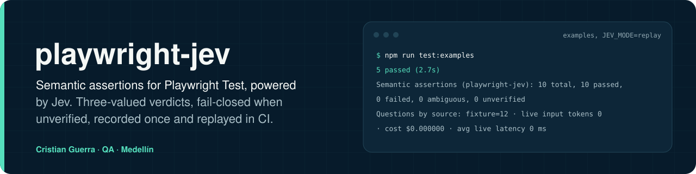
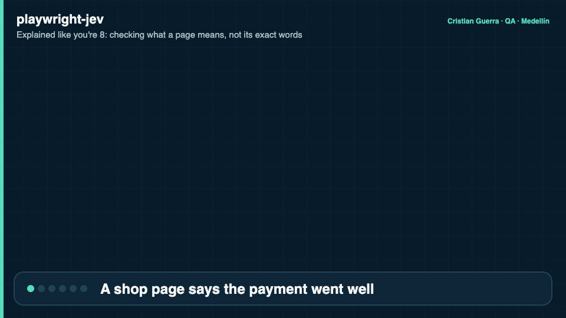
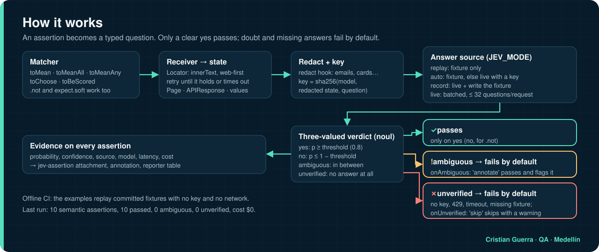
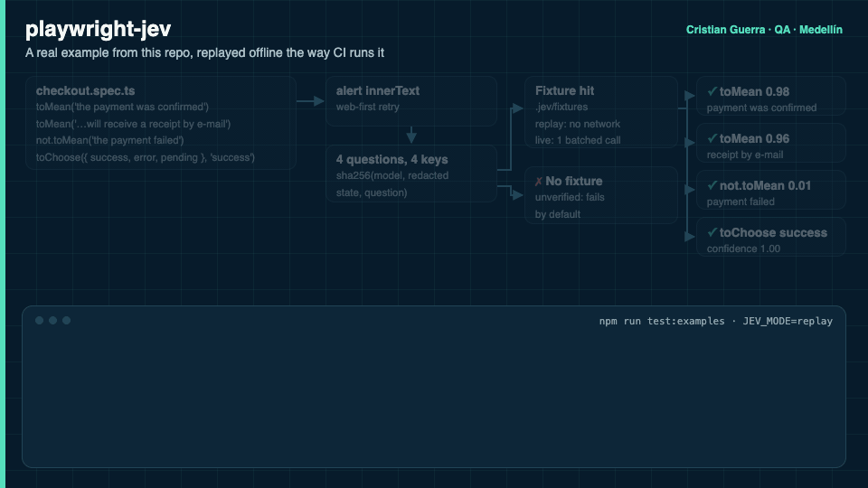

# playwright-jev

[Leer en español](README.es.md)



## Explained like you're 8

When a shop website says "Payment successful. Your order is confirmed.", a normal test checks whether some exact words are on the screen. If someone rewrites the sentence, that test breaks even though the page is fine. This project lets a test ask what the page **means**: "does it say the payment was confirmed?". Jev answers with how sure it is. Only a clear yes passes; if Jev is in the middle or doesn't answer, the test fails on purpose, so nothing slips by. The answers can be saved, so the tests run again the same way without internet.

**A real example from this repo**

- **Imagine** a checkout page that shows: "Payment successful. Your order A-1001 is confirmed. A receipt was sent to ana@example.com."
- **What happens:** the test wants to know if "the payment was confirmed". Those exact words are not on the page, so a word-for-word check would fail, even though the page is right.
- **What the project does:** Jev reads the meaning and says **98%** yes. For "the payment failed" it says **1%**, which is what we want. Both checks pass.
- **What we gain:** tests that don't break when the wording changes, and that still fail when the page really says something else. In CI the 10 meaning checks pass from saved answers, with no internet and no key.



[MP4 version](docs/assets/explained.mp4) · source: [`docs/scenes/explained.html`](docs/scenes/explained.html)

**Hard words**

| Word | What it means |
| --- | --- |
| Playwright | A tool that drives a web browser by itself, like a robot clicking for you |
| Assertion | The "is this true?" line inside a test |
| Jev | A fast AI that doesn't write sentences: it answers yes or no and says how sure it is |
| Threshold | How sure Jev must be (80% by default) for a yes to count |
| Fixture | A saved answer from Jev, so the test can run again without asking |
| CI | A robot that runs the tests every time someone hands in a change |

---

Semantic assertions for [Playwright Test](https://playwright.dev), powered by
[Jev](https://docs.typesafe.ai) from TypeSafe AI.

```ts
await expect(page.getByRole('alert')).toMean('the payment was confirmed');
await expect(summary).toMeanAll(['the order total is shown', 'the page says when it will arrive']);
await expect.soft(alert).not.toMean('the payment failed');
await expect(banner).toChoose(['success', 'error', 'pending'], 'success');
await expect(article).toBeScored(['unclear', 'partly clear', 'clear'], { atLeast: 1.5 });
```

[](https://github.com/criguex/playwright-jev/actions/workflows/ci.yml)
License: MIT · Node ≥ 20 · `@playwright/test` ≥ 1.45

## Why

A locator assertion answers "is this exact string on the screen?". An acceptance
criterion usually asks something else: "does the screen tell the user the payment went
through?". When copy is rewritten, translated or A/B tested, the first kind of test
breaks while the product is fine, and a regex that tries to cover every wording ends up
asserting nothing.

Jev is a "System One" model: it takes a state and typed questions and returns calibrated
probabilities instead of prose, in a few hundred milliseconds, at $0.042 per million input
tokens. That makes it usable as an assertion oracle, as long as the library around it is
strict about uncertainty. This one is:

- **Three-valued verdicts.** Every answer is `yes`, `no` or `ambiguous`. Ambiguity fails by
  default, in both `toMean` and `.not.toMean`.
- **Fail-closed.** No key, a 429 after retries, a timeout or a missing fixture make the
  assertion *unverified*, and unverified never passes.
- **Evidence on every assertion.** Probability, confidence, distribution, source, model,
  latency and cost are attached to the Playwright report and listed by the reporter.
- **Offline CI.** Record answers once, commit the fixtures, replay deterministically without
  a key or network.

### How this differs from what exists

| Project | Scope |
| --- | --- |
| [pytest-jev](https://github.com/allebee/pytest-jev) | Python / pytest |
| [jevtest](https://github.com/realZachi/jevtest) | Vitest and Jest matchers (`toSatisfy`), no Playwright |
| [jev-playwright](https://www.npmjs.com/package/jev-playwright) | Picks which Playwright tests to run for a diff, not assertions |
| playjev, jev-browser | Browser automation agents |
| **playwright-jev** | Playwright Test matchers: `Locator`/`Page` receivers with web-first retry, noul/choice/score matchers, ambiguity band, Playwright annotations, attachments and reporter |

## How it works





The animation follows the checkout example in [`examples/checkout.spec.ts`](examples/checkout.spec.ts) and shows the real output of `npm run test:examples` (replay mode, no key) ([MP4 version](docs/assets/how-it-works.mp4)). Source: [`docs/scenes/how-it-works.html`](docs/scenes/how-it-works.html), rendered with [`docs/scenes/export.sh`](docs/scenes/export.sh).

## Quick start

The package is not published on npm yet (`npm i -D playwright-jev` returns 404).
Install it from GitHub; the `prepare` script builds `dist/` during the install.

```sh
npm i -D github:criguex/playwright-jev
export TYPESAFE_API_KEY=...        # or AI_GATEWAY_API_KEY=... for Vercel AI Gateway
```

```ts
// tests/checkout.spec.ts
import { test } from '@playwright/test';
import { expect } from 'playwright-jev';

test('a successful payment is communicated as a confirmation', async ({ page }) => {
  await page.goto('/checkout');
  await page.getByRole('button', { name: 'Pay now' }).click();
  const alert = page.getByRole('alert');

  await Promise.all([
    expect.soft(alert).toMean('the payment was confirmed'),
    expect.soft(alert).toMean('the customer will receive a receipt by e-mail'),
    expect.soft(alert).not.toMean('the payment failed'),
  ]);
});
```

Those three assertions read the same text and go to Jev as **one** request.

Add the reporter to `playwright.config.ts`:

```ts
import { defineConfig } from '@playwright/test';

export default defineConfig({
  reporter: [['list'], ['playwright-jev/reporter', { markdownFile: 'jev-report.md' }]],
});
```

Already have a custom `expect`? Merge the matchers instead:

```ts
import { expect as base, mergeExpects } from '@playwright/test';
import { jevMatchers } from 'playwright-jev';

export const expect = mergeExpects(myExpect, base.extend(jevMatchers));
```

## API

| Matcher | Jev primitive | Passes when |
| --- | --- | --- |
| `toMean(claim, opts?)` | noul | p ≥ `threshold` (default 0.8). `.not`: p ≤ 1 − threshold |
| `toMeanAll(claims, opts?)` | noul × N, one request | every claim is `yes` (Kleene AND) |
| `toMeanAny(claims, opts?)` | noul × N, one request | at least one claim is `yes` (Kleene OR) |
| `toBeScored(rubric, { atLeast, atMost?, minConfidence? })` | score | `atLeast ≤ score ≤ atMost` and confidence ≥ `minConfidence` (0.5) |
| `toChoose(options, expected, { question?, minConfidence? })` | choice | chosen option ∈ `expected` and confidence ≥ `minConfidence` |

Receivers:

| Receiver | What is judged | Retries |
| --- | --- | --- |
| `Locator` | `innerText` of all matches, after the first is visible | yes, until the expectation holds or `timeout`; Jev is only re-asked when the text changes |
| `Page` | `body` inner text | yes |
| `string`, `number`, `boolean` | the value | no |
| `APIResponse` | parsed JSON body, or text | no |
| object / array | the JSON value | no |

Options shared by all matchers: `timeout`, `poll` (default `true`), `context` (extra
state, e.g. `"error banner on the login form"`), `model`, `onAmbiguous`, `onUnverified`.
`toMean*` also take `threshold`.

Rubrics are ordered lowest first; `atLeast` and `atMost` use 0-based level indexes and
can be fractional, since Jev returns a probability-weighted score. Options for
`toChoose` can be a list of labels or a map of label to description (up to 255).

Low-level building blocks are exported too: `createJevClient`, `decide`,
`claimQuestion`, `choiceQuestion`, `scoreQuestion`, `normalizeAnswer`, `redactors`,
`getJevStats`. Full reference: `npm run docs` (typedoc, `docs/api`).

### Failure output

```
Error: expect(locator).toMean("the payment was confirmed")

Verdict:  no (expected yes)
Thresholds: yes ≥ 0.80, no ≤ 0.20
Answers:
  - "the payment was confirmed": no (p=0.04, live)
Received (locator): "Card declined. Please try another payment method."
Model: jev-1.13.0
```

## Record / replay

```sh
JEV_MODE=record npx playwright test     # calls Jev, writes .jev/fixtures/<hash>.json
git add .jev/fixtures
JEV_MODE=replay npx playwright test     # no key, no network, deterministic
```

| `JEV_MODE` | Behaviour |
| --- | --- |
| `auto` (default) | fixture if present, else live if a key is set, else unverified |
| `live` | always call Jev (in-memory cache still applies) |
| `record` | call Jev and write one fixture per question |
| `replay` | fixtures only; a missing fixture is unverified |
| `off` | every semantic assertion is unverified |

The fixture key is `sha256(model, redacted state, question)`. If the page copy changes,
the key changes and replay reports the missing fixture instead of approving content that
was never judged. This repository's `examples/` run in CI exactly this way, from fixtures
recorded against the live model.

## Configuration

Call `configureJev` at the top of `playwright.config.ts` (the file is evaluated in every
worker) or use environment variables. Per-assertion options win over `configureJev`,
which wins over the environment.

```ts
import { configureJev, redactors } from 'playwright-jev';

configureJev({
  threshold: 0.85,
  onAmbiguous: 'fail',
  onUnverified: 'fail',
  redact: [redactors.emails, redactors.cardNumbers, redactors.digitRuns(8)],
  context: 'web shop checkout',
});
```

| Option | Env | Default |
| --- | --- | --- |
| `mode` | `JEV_MODE` | `auto` |
| `model` | `JEV_MODEL` | `jev-latest` (pin e.g. `jev-1.13.0` after tuning thresholds) |
| `threshold` | `JEV_THRESHOLD` | `0.8` |
| `minConfidence` | | `0.5` |
| `onAmbiguous` | `JEV_ON_AMBIGUOUS` | `fail` (`annotate` passes with a `jev:ambiguous` annotation) |
| `onUnverified` | `JEV_ON_UNVERIFIED` | `fail` (`skip` skips the test with a warning) |
| `fixturesDir` | `JEV_FIXTURES_DIR` | `.jev/fixtures` |
| `apiKey` | `TYPESAFE_API_KEY` | |
| `gatewayApiKey` | `AI_GATEWAY_API_KEY` | |
| `baseUrl` | `JEV_BASE_URL` | TypeSafe, else Vercel AI Gateway |
| `requestTimeoutMs` | | `15000` (covers retries) |
| `maxRetries` / `maxRetryDelayMs` | | `2` / `8000` |
| `batchWindowMs` / `maxQuestionsPerRequest` | | `20` / `32` |
| `maxStateChars` | | `60000` (longer text is truncated and flagged) |
| `redact` | | `[]` |
| `pricePerMillionInputTokens` | | `0.042` |

Transport: with `TYPESAFE_API_KEY` requests go to `https://api.typesafe.ai/v1/systemone`;
with only `AI_GATEWAY_API_KEY` they go to
`https://ai-gateway.vercel.sh/typesafe/v1/systemone`. The gateway's
`{ type: 'boolean', probability }` answers are normalized to the native noul shape.
Errors are logged with the response body and the key scrubbed.

## Reporter

```
Semantic assertions (playwright-jev): 10 total, 10 passed, 0 failed, 0 ambiguous, 0 unverified
STATUS     MATCHER         P/SCORE       CONF  SOURCE   TEST · EXPECTATION
passed     toMean          0.98          -     fixture  checkout › a successful payment … · "the payment was confirmed"
passed     not.toMean      0.01          -     fixture  checkout › a successful payment … · "the payment failed"
passed     toChoose        success       1.00  fixture  checkout › a successful payment … · "success"
passed     toBeScored      1.87          0.80  fixture  the help article explains the steps clearly · score in [1.5, 2] …
passed     toMeanAll       0.99/0.93     -     fixture  checkout › the order summary covers what a buyer needs · […]
Questions by source: fixture=12 · live input tokens 0 · cost $0.000000 · avg live latency 0 ms
```

Options: `outputFile` (`jev-report.json`), `markdownFile`, `print`, `failOnAmbiguous`,
`failOnUnverified` (turn tolerated ambiguity or skips into a failed run). Relative
`outputFile` and `markdownFile` paths are resolved from the directory of the Playwright
config file. Each assertion
is also a `jev-assertion` JSON attachment and an annotation (`jev`, `jev:failed`,
`jev:ambiguous`, `jev:unverified`) visible in the HTML report.

## Honest limits

- **Jev can pick a wrong but valid option.** A calibrated 0.95 is still wrong 1 time in 20
  on average. Keep deterministic assertions for anything that has an exact expected value.
- **Confidence is self-reported.** It is derived from the model's own distribution. Measure
  on your content before trusting a threshold; pin the model version once you have tuned it.
- **Not for math, dates or counting.** jev-1.13 is weak at numeric precision, date
  comparison and counting. Extract values in code and compare them in code.
- **Literal reading.** Jev answers the claim you wrote. "The payment was confirmed" and
  "an order was placed" are different claims; phrase them as the acceptance criterion does.
- **Prompt injection.** Page text is untrusted. The claim travels as structured data with an
  explicit instruction to ignore instructions inside the content (ADR 0005 has the probe
  numbers), which reduces but does not remove the risk. Do not gate security decisions on
  semantic assertions over attacker-controlled text.
- **Data leaves the machine.** Page text is sent to TypeSafe or Vercel. Use `redact`, keep
  regulated data out, and review fixtures before committing them.
- **English first.** Other languages work with lower accuracy.
- **Text only.** Images, canvas and visual layout are not judged.
- **Costs and limits are external.** Rate limits change without notice (a fresh gateway
  account allowed 5 requests per minute while this was written); batch and replay.

## Comparison with LLM-as-judge

| | playwright-jev (Jev) | Generative LLM as judge |
| --- | --- | --- |
| Output | Typed probability / choice / score | Free text you must parse |
| Hallucinated rationale | None (no text is generated) | Possible |
| Calibration | Trained to be calibrated; ambiguity is visible | Usually over-confident, needs sampling |
| Latency | ~0.2 to 1 s per request, many questions in parallel | Seconds per question |
| Cost | $0.042 per million input tokens, output free | Orders of magnitude more |
| Determinism in CI | Record/replay fixtures | Temperature, sampling, drift |
| Explanations | None: you get numbers and the evidence attached | Can explain (and be wrong about it) |
| Best for | Many narrow yes/no, pick-one and rubric checks | Open-ended review, long reasoning |

## Project layout

| Path | What it holds |
| --- | --- |
| `src/` | The library: matchers, receivers, engine, client, store and reporter |
| `test/unit/` | Vitest unit tests against a local mock Jev server (`npm test`) |
| `test/integration/` | Playwright suite against a local checkout page and the mock (`npm run test:integration`) |
| `test/live/` | Optional smoke test against the real Jev API, needs a key (`npm run test:live`) |
| `test/support/` | Mock Jev server and helpers shared by the unit and integration suites |
| `examples/` | Example specs and their committed fixtures, replayed offline (`npm run test:examples`) |
| `scripts/` | `check-pack.mjs`: packs the tarball and loads it as ESM and CJS |
| `docs/` | ADRs, plan, definition of done, README images and animation sources |
| `.github/workflows/` | CI on every push and the manual release workflow |

Generated and ignored: `dist/`, `coverage/`, `test-results/`, `docs/api/`.

## Project docs

- [docs/PLAN.md](docs/PLAN.md): scope, architecture and phases
- [docs/GOAL.md](docs/GOAL.md): machine-checkable definition of done
- [docs/adr](https://github.com/criguex/playwright-jev/tree/main/docs/adr): design decisions
- [CONTRIBUTING.md](CONTRIBUTING.md), [CHANGELOG.md](CHANGELOG.md)

## Releasing

Publishing is manual on purpose. The `Release` workflow (`workflow_dispatch`) runs
`npm run verify` and `npm publish --provenance` with an `NPM_TOKEN` secret. It has never
been run.

## Español

Versión completa en español: [README.es.md](README.es.md).

**playwright-jev** agrega aserciones semánticas a Playwright Test usando Jev (TypeSafe AI):
en lugar de comparar textos exactos, verifica lo que la pantalla *significa*.

```ts
await expect(page.getByRole('alert')).toMean('el pago fue confirmado');
```

- Veredictos de tres valores (`yes`, `no`, `ambiguous`); lo ambiguo falla por defecto.
- Si no se pudo verificar (sin clave, error de red, fixture faltante) la aserción falla:
  nunca pasa en silencio. Opcionalmente `onUnverified: 'skip'` salta la prueba con aviso.
- Graba una vez con `JEV_MODE=record`, versiona `.jev/fixtures` y en CI usa
  `JEV_MODE=replay`: sin clave, sin red y determinista.
- Varias aserciones concurrentes sobre el mismo contenido viajan en una sola petición.
- Hook `redact` para quitar datos personales antes de enviarlos.
- Reporter con probabilidad, confianza, fuente, latencia y costo por aserción.

Límites: Jev puede elegir una opción válida pero equivocada, la confianza es
autorreportada, no sirve para cálculos, fechas ni conteos, y el texto de la página puede
intentar manipular la respuesta. Úsalo junto a las aserciones deterministas, no en su lugar.
Funciona mejor en inglés.

## License

MIT © Cristian Guerra

## Author

Cristian Guerra · QA · Medellín · [github.com/criguex](https://github.com/criguex)
